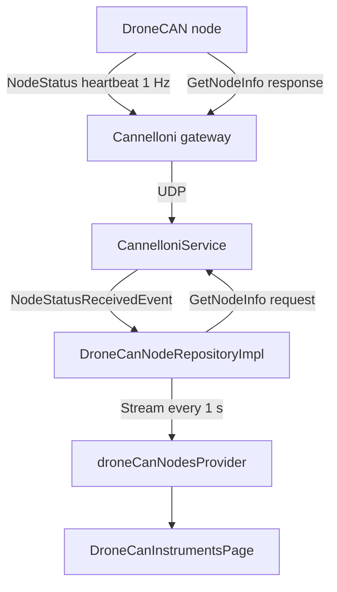
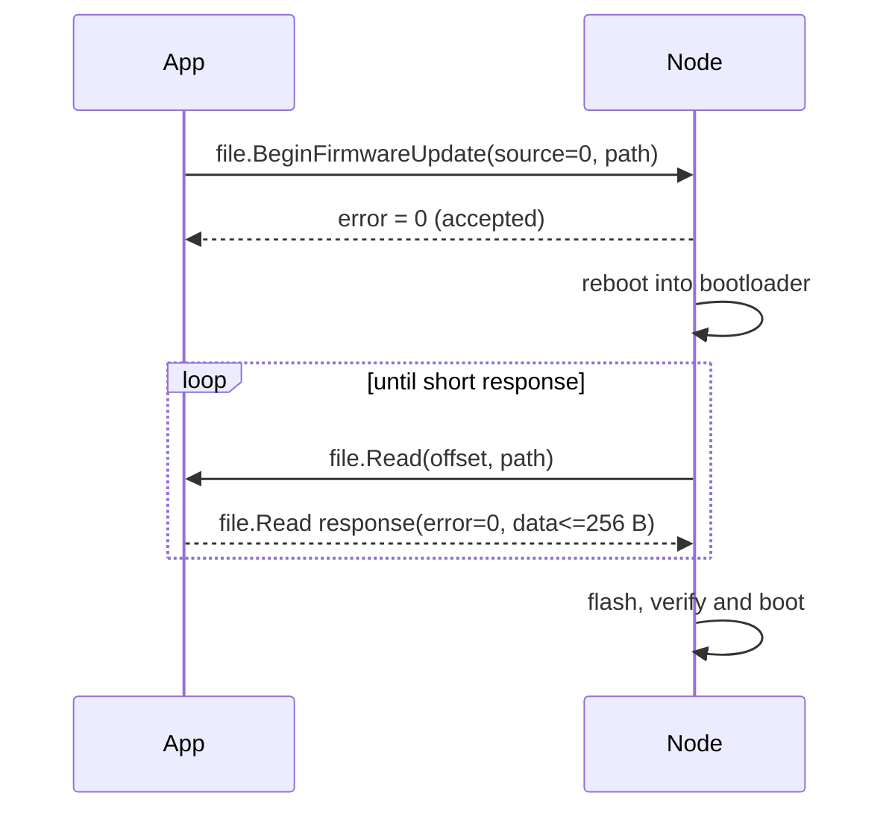

# DroneCAN Instruments

This document describes the **DroneCAN instruments** page: a live table of all
flight instruments (DroneCAN nodes) currently visible on the CAN bus.

---

## 1. Overview

The page is available from the map drawer as **DroneCAN instruments** and lives
at `/dronecan-instruments`. The menu item is shown while a Cannelloni gateway is
selected (connected), since the list is purely live DroneCAN data. It shows one
row per discovered node with:

| Column | Source |
| :--- | :--- |
| Node ID | `source_node_id` of the received transfer |
| Name | `uavcan.protocol.GetNodeInfo` response |
| Unique ID | `uavcan.protocol.GetNodeInfo` response (128-bit hardware ID, hex) |
| Health | `uavcan.protocol.NodeStatus` heartbeat |
| Mode | `uavcan.protocol.NodeStatus` heartbeat |
| Uptime | `uavcan.protocol.NodeStatus` heartbeat (`uptime_sec`) |
| Last seen | Time elapsed since the last received heartbeat (computed locally) |

**Nothing is persisted.** The registry exists only in memory for the lifetime of
the page and is cleared whenever the Cannelloni/DroneCAN link is reset.

---

## 2. Discovery flow

1. Every DroneCAN node broadcasts `uavcan.protocol.NodeStatus` (ID 341) once per
   second. The transfer is accepted by
   [CannelloniService](../../lib/core/services/cannelloni_service_io.dart) and
   parsed into a [NodeStatus](../../lib/core/native/dronecan/node_status.dart).
2. The service emits a `NodeStatusReceivedEvent` on `nodeStatusEvents`.
   Heartbeats from the app's own node ID are ignored.
3. [DroneCanNodeRepositoryImpl](../../lib/features/dronecan_devices/data/repositories/dronecan_node_repository_impl.dart)
   upserts the node (health, mode, uptime, `lastSeen`) and, while the name or
   unique ID is still unknown, sends a `uavcan.protocol.GetNodeInfo` (ID 1)
   service request to that node.
4. The response is parsed by
   [GetNodeInfoResponse.fromPayload](../../lib/core/native/dronecan/get_node_info.dart)
   and fills in the name, unique ID, software version (major/minor, VCS commit,
   image CRC), hardware version and certificate of authenticity.
5. The repository emits a snapshot immediately on subscription, whenever data
   changes, and once per second so the UI can recompute "last seen".

A node that does not answer `GetNodeInfo` (for example because it does not
implement the service) is retried with an exponential back-off — 5 s, 10 s,
20 s, … capped at 60 s — so the bus is not polled every few seconds forever.
The back-off is reset by a manual refresh, a restart, a firmware update or a
link reset.

The refresh button in the app bar reports its outcome in a snack bar, because a
node that does not implement `GetNodeInfo` never answers: the message shows how
many of the known nodes responded, and distinguishes a full refresh, a partial
one, an empty registry and a failed request.

"Last seen" is shown as `Hh Mm S.s` (hours, minutes and seconds with one
decimal place).

A node that stops sending heartbeats stays in the table with an increasing
"last seen" value until the link is reset.

---

## 3. Node details dialog

Tapping the node **name** in the table opens a draggable
`BaseDetailsDialog`. Its header shows the node name together with a distinct
**node ID badge** (so the ID cannot be mistaken for part of the name). The body
contains only the `GetNodeInfo`-specific data that is not already visible in the
table:

| Field | Source |
| :--- | :--- |
| Vendor status code | `NodeStatus` heartbeat (`vendor_specific_status_code`, hex; `---` when `0`) |
| Software version | GetNodeInfo (`major.minor`) |
| VCS commit | GetNodeInfo (`vcs_commit`, hex) |
| Image CRC | GetNodeInfo (`image_crc`, 64-bit hex) |
| Hardware version | GetNodeInfo (`major.minor`) |
| Certificate of authenticity | GetNodeInfo (hex, or `---` when empty) |

The dialog follows the live node registry instead of freezing the row that was
tapped, so uptime, mode and the `GetNodeInfo` fields (firmware version, hardware,
certificate) update on their own — e.g. after a node restart or a firmware
update. While the node is rebooting its cached `GetNodeInfo` data is dropped and
the dialog shows the short "details are not available yet" message until the
node answers again.

Live data (node ID, name, unique ID, health, mode, uptime, last seen) stays only
in the table. The vendor status code is shown in the dialog because it is
node-specific rather than a standard column. If a node did not answer
`GetNodeInfo` yet, the dialog still shows the vendor status code and a short
"details are not available yet" message.

### 3.1. Node actions

The dialog also exposes node management actions (disabled while a request is in
flight or when the gateway is disconnected):

| Action | DroneCAN service | Behaviour |
| :--- | :--- | :--- |
| **Restart** | `uavcan.protocol.RestartNode` (ID 5) | Shows a confirmation that spells out the risks (node unavailable for a few seconds, unsaved node configuration is lost, never in flight, may stay offline until power cycle); the confirm button is destructive and labelled "Restart anyway". The request is sent with `MAGIC_NUMBER` and the outcome is reported |
| **Transport stats** | `uavcan.protocol.GetTransportStats` (ID 4) | Opens a live dialog: the statistics are re-read once per second and every counter is shown with the change since the previous reading in brackets, so it doubles as a per-second rate meter. Transfer counters and per-CAN-interface frame/error counters are included |
| **Update firmware** | `uavcan.protocol.file.BeginFirmwareUpdate` (ID 40), `uavcan.protocol.file.Read` (ID 48) | Opens the firmware upload described in section 5 |
| **Configuration** | `uavcan.protocol.param.GetSet` (ID 11), `uavcan.protocol.param.ExecuteOpcode` (ID 10) | Opens the parameter table described in section 4 |

`RestartNode` and `GetTransportStats` share their message IDs with the
`Panic` (ID 5) and `GlobalTimeSync` (ID 4) broadcasts, so the accept callback
matches only `response` transfers for those IDs.

---

## 4. Configuration dialog

The **Configuration** action opens a parameter table of the node. Nothing is
persisted locally: the values live in the node and are read on demand.

### 4.1. Reading the parameters

The node is scanned by index, so the table fills up progressively instead of
waiting for the whole list:

1. `param.GetSet` (ID 11) is sent with `index = 0`, `value = void`, `name`
   empty.
2. The response carries the parameter `name`, `value` and — when the node
   supports it — `default_value`, `max_value` and `min_value`.
3. The index is incremented until the node answers with an empty name (or a
   request times out), which is how the end of the list is detected.

The scan itself is a repository concern
(`DroneCanNodeRepository.watchParameters`): it streams a growing snapshot of the
parameters, starting with an empty list, and fails the stream if a read fails.
The notifier only maps those snapshots to the dialog state, so the scanning
policy (index order, safety limit, partial results) is testable without
Riverpod.

Each request uses a 500 ms timeout so a node that stops answering cannot stall
the dialog. A read that times out is retried once (a single lost CAN frame
would otherwise truncate the list in the middle); other failures are not
retried. Parameters read before a failure stay in the table and the scan
reports the error; if the very first request fails the dialog shows a "reading
the parameters failed" message instead.

### 4.2. Table

| Column | Content |
| :--- | :--- |
| ID | Parameter index in the node's list (`param.GetSet` index scan) |
| Name | Parameter name |
| Type | `integer`, `real`, `boolean`, `string` (from the `Value` union tag) |
| Value | Current value; values that differ from the reported default are highlighted and the default is shown underneath |
| Edit | Opens the value editor |

Nodes that do not report a default (e.g. ArduPilot AP_Periph) never mark a
parameter as modified. Nodes that do not report bounds are editable without a
range check.

### 4.3. Writing a value

The editor shows the type together with the reported minimum, maximum and
default. Saving sends `param.GetSet` **by name** with the new `Value` (a set by
index is not supported by most nodes), so the value is applied in the node
immediately. The response is authoritative: the table shows the value the node
reports after the set, while the previously read metadata is kept when the
response omits it. Values outside the reported bounds are rejected by the dialog
before the request is sent.

### 4.4. Store and erase

| Button | `ExecuteOpcode` | Behaviour |
| :--- | :--- | :--- |
| **Refresh** | — | Re-reads the whole parameter list |
| **Store all** | `OPCODE_SAVE` (0) | Writes the current configuration to the node's non-volatile storage; the outcome is reported in a snackbar |
| **Erase all** | `OPCODE_ERASE` (1) | Destructive: asks for confirmation, clears the non-volatile storage (parameters fall back to their defaults, the node may need a restart) and re-reads the table |

### 4.5. Wire format notes

`uavcan.protocol.param.Value` is a union with a 3-bit tag, `NumericValue` a
union with a 2-bit tag; the `GetSet` response pads them with `void5`/`void6`
fields. `BitReader`/`BitWriter` mirror libcanard's scalar codec (little-endian
scalars, most significant bit first in the transfer), which keeps the layout
byte-exact.

`name` is the last field of the request and of the response, so DroneCAN on
classic CAN omits its 7-bit length prefix (tail array optimization). Requests
are therefore sent without the prefix — appending a zero padding byte would
make the node read it as part of the name, which is why the payload is not
padded. Responses are decoded both with and without the prefix, so libuavcan v0
based nodes (which always send the prefix) are supported as well. The width of
the prefix follows the array capacity — 7 bits for `uint8[<=92]`, 8 bits for
`uint8[<=200]` and `uint8[<=256]`.

---

## 5. Firmware update

The **Update firmware** action opens a dialog where the user picks a DroneCAN
firmware image (`.bin`) from the device and watches the transfer. The image is
uploaded to the node directly over the CAN bus — nothing is stored in the app.

### 5.1. Flow

DroneCAN firmware update is **pulled** by the node, so the app acts as a file
server and the node as the client:

1. The app sends `uavcan.protocol.file.BeginFirmwareUpdate` (ID 40) to the
   node with `source_node_id = 0` (meaning "the sender of the request") and a
   file name, e.g. `AP_Periph.bin`. The name is opaque: the node only echoes it
   back when it asks for data.
2. The node answers with `error` (0 = accepted); otherwise the dialog shows the
   error code together with the node's message.
3. The node restarts into its bootloader and requests the image with
   `uavcan.protocol.file.Read` (ID 48) transfers addressed to this app. Each
   request carries a byte `offset` and the file name.
4. The app answers from memory with up to 256 bytes. **A response shorter than
   256 bytes marks the end of the image** — that is how the node detects it has
   everything. When the image size is an exact multiple of 256 the last chunk
   is full-sized, so the node asks once more at `offset == size` and receives an
   empty chunk (see 5.2).
   Because the node waits for each response before asking for the next chunk,
   the queued reply is sent immediately instead of waiting for the 100 ms
   periodic TX pump. That pump writes into its own preallocated buffer, because
   the receive buffer is still being parsed by the native transfer loop that
   invoked the handler.
5. The node writes the image to flash, verifies it and boots the new firmware.
   The cached `GetNodeInfo` of the node is dropped, so the new version is read
   as soon as the node reports again.

### 5.2. Progress and timeouts

- The progress is the highest byte offset served so far divided by the image
  size; the bar reaches 100 % when the last chunk is handed over.
- After the last chunk the image is still served for a 3 s grace period so a
  retried read is not answered with "file not found".
- Two variants of the end of the image are distinguished:
  - the last chunk is **shorter** than 256 bytes → the node sees the end of the
    file immediately and the 3 s grace period starts;
  - the last chunk is **exactly 256 bytes** (image size is a multiple of 256) →
    it means "more data", so the node still has to probe `offset == size` and
    must get an empty chunk. The image is served for up to 15 s while that probe
    is expected, and the grace period restarts once it arrives.
- The progress reaches 100 % as soon as the whole image has been handed over,
  which for a multiple-of-256 image is one request before the node's
  end-of-file probe.
- The node must ask for the first chunk within 20 s and must not stop asking
  for more than 10 s while data is missing, otherwise the update fails with a
  timeout. Both are generous because a node has to reboot into its bootloader
  first.
- Cancelling the dialog during the upload stops serving the image; the node
  then aborts the update itself.

### 5.3. Finishing an update

When the node has the whole image the dialog shows the completed state, but it
closes only once the upload session has actually finished — i.e. after the
grace/end-of-file period described in 5.2. Closing earlier would unregister the
`file.Read` handler and the node's last probe or retried read would be answered
with "file not found", which can abort the update. Until then the dialog cannot
be dismissed (close button, tapping outside, back gesture). Once the session
ends the dialog closes on its own and the outcome is shown as a snackbar
(`Firmware uploaded. The node verifies the image and restarts with the new
version.`). The node details dialog behind it needs no manual refresh: the
cached `GetNodeInfo` was dropped when the image was served, so it shows the
"details are not available yet" message while the node reboots and the new
firmware version as soon as the node reports again.

### 5.4. Safety

The dialog spells out the risks (never in flight, do not cut power or the CAN
link, the node restarts). While the upload is running it cannot be dismissed —
not by the close button, not by tapping outside, not by the back gesture or Esc
— because closing it aborts the transfer and leaves the node in its bootloader;
the only way out is the explicit **Cancel** button.
`file.Read` requests are only answered for the node and file name of the
running update.

---

## 6. Layer structure

| Layer | File |
| :--- | :--- |
| Protocol | `lib/core/native/dronecan/node_status.dart`, `get_node_info.dart`, `restart_node.dart`, `get_transport_stats.dart`, `param_get_set.dart`, `file_services.dart`, `bit_reader.dart`, `bit_writer.dart`, `tail_array.dart` |
| Transport | `lib/core/services/cannelloni_service_io.dart` (`nodeStatusEvents`, `getNodeInfo`, `restartNode`, `getTransportStats`, `getSetParameter`, `executeParameterOpcode`, `beginFirmwareUpdate`, `fileReadHandler`) |
| Domain | `lib/features/dronecan_devices/domain/models/dronecan_node.dart`, `domain/models/dronecan_node_info_refresh.dart`, `domain/models/dronecan_parameter.dart`, `domain/models/firmware_update_progress.dart`, `domain/models/firmware_update_failure.dart`, `domain/models/dronecan_result.dart`, `domain/models/transport_statistics.dart`, `domain/repositories/dronecan_node_repository.dart` |
| Data | `lib/features/dronecan_devices/data/repositories/dronecan_node_repository_impl.dart`, `data/mappers/dronecan_protocol_mappers.dart`, `data/services/firmware_upload_session.dart`, `data/services/firmware_file_picker.dart` |
| Presentation | `lib/features/dronecan_devices/presentation/providers/dronecan_nodes_provider.dart` (node stream + repository provider), `presentation/providers/dronecan_node_actions_provider.dart` (restart, transport stats, refresh with `DroneCanResult`), `presentation/providers/dronecan_configuration_provider.dart`, `presentation/providers/dronecan_firmware_update_provider.dart` (notifier + file picker provider), `presentation/providers/dronecan_transport_stats_provider.dart` (1 Hz statistics polling), `presentation/components/dronecan_node_header.dart`, `presentation/pages/dronecan_instruments_page.dart`, `presentation/dialogs/dronecan_node_details_dialog.dart`, `presentation/dialogs/dronecan_configuration_dialog.dart`, `presentation/dialogs/dronecan_parameter_edit_dialog.dart`, `presentation/dialogs/dronecan_firmware_update_dialog.dart`, `presentation/dialogs/dronecan_transport_stats_dialog.dart`, `presentation/utils/dronecan_formatters.dart` |

The domain layer owns its vocabulary: `DroneCanNode` uses `DroneCanNodeHealth`
and `DroneCanNodeMode`, `DroneCanParameter` uses the `DroneCanParamValue` union
and `DroneCanResult` wraps user-triggered operations, so no protocol type from
`core/native/dronecan` leaks into the domain or the UI. The data layer maps
between both models in `data/mappers/dronecan_protocol_mappers.dart`.

The transport abstraction
([DroneCanNodeTransport](../../lib/core/services/dronecan_node_transport.dart))
is implemented by both the IO and the web stub service, so the page builds on all
platforms. On the web the node list stays empty because there is no CAN
transport.
