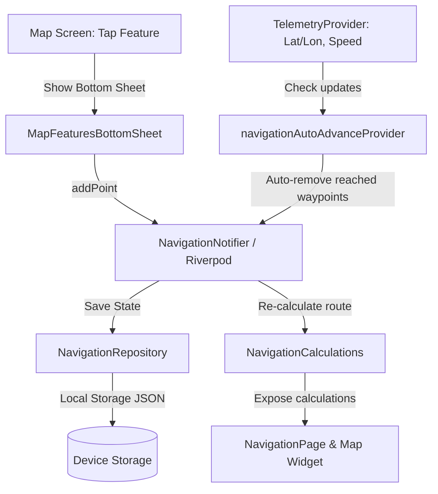

# Waypoint Navigation System

This document describes the design, models, dynamic telemetry calculations, auto-advance logic, and UI components of Stork's point-to-point waypoint navigation system.

---

## 1. System Overview

Stork allows pilots to define a sequential flight path (route) composed of waypoints. Users can:
- Tap on aeronautical features on the map (such as airports, towns/places, or raw map coordinates) to open a bottom sheet and add points to the route.
- Track real-time progress along the route, showing distance, Estimated Time Enroute (ETE), and Estimated Time of Arrival (ETA) for each segment (leg) and for the overall destination.
- Reorder or delete waypoints on the fly.
- Activate or pause navigation tracking.

---

## 2. Architecture and Data Flow

The navigation feature is split into domain models, data repository, and reactive providers:



Route state, models and persistence live in `lib/features/route/`. Weather planning consumes the route state without importing navigation UI. Weather owns the wind-adjusted timing (`route_timing_provider.dart`), while the navigation-facing `NavigationCalculations` aggregate lives with the navigation UI, so navigation pages consume both the route state and the weather timing providers.

### 2.1. Domain Models
The navigation domain is built on three core classes:

1.  **[NavigationPoint](../../lib/features/route/domain/models/navigation_point.dart)**: Represents a single waypoint.
    *   `latitude` and `longitude`: The geographic location.
    *   `name`: The display label (e.g., airport name, ICAO code, place name, or coordinate string).
    *   `isAirport`: Flag identifying if the point is an airport (which shows specific airport icons in list items and menus).
2.  **[NavigationState](../../lib/features/route/domain/models/navigation_state.dart)**: The overall state of the navigation.
    *   `points`: The ordered list of active `NavigationPoint`s.
    *   `isActive`: A boolean indicating whether route tracking is active.
3.  **[NavigationLeg](../../lib/features/route/domain/models/navigation_leg.dart)**: Represents a segment of the flight route.
    *   `point`: The target waypoint.
    *   `legDistanceMeters`: The distance from the previous point (or aircraft's current location) to this waypoint.
    *   `legDuration`: ETE for this specific leg.
    *   `cumulativeDistanceMeters`: Total distance from the aircraft's current position to this waypoint.
    *   `cumulativeDuration`: Total ETE from the aircraft's current position to this waypoint.
    *   `eta`: Estimated Time of Arrival at this waypoint.

---

## 3. Dynamic Telemetry Calculations

When navigation is active, the system continuously calculates flight parameters in [navigationEtaProvider](../../lib/features/navigation/presentation/providers/navigation_eta_provider.dart). It builds `NavigationCalculations` from the wind-adjusted [routePointTiming](../../lib/features/weather/presentation/providers/route_timing_provider.dart) and falls back to the aircraft/GPS speed when no forecast wind is available.

### 3.1. Speed Source Resolution
The speed used to calculate travel times is resolved dynamically:
- **In-flight (Ground Speed)**: If the aircraft is flying (`telemetry.isFlying == true`) and GPS ground speed is available (`telemetry.groundSpeed != null && telemetry.groundSpeed > 0`), the system uses the real-time ground speed.
- **Pre-flight / Fallback (Average Speed)**: If the aircraft is stationary or GPS speed is unavailable, it falls back to the selected aircraft's cruising speed (the default is 100 km/h). The same default is used when no aircraft is selected.

### 3.2. Calculations Sequence
1.  **Start Reference**: The calculations start from the aircraft's current coordinates (`currentLatitude`, `currentLongitude`).
2.  **Geographic Distance**: For each waypoint in the list, the distance from the last reference coordinate is computed using the Haversine formula via `GeoUtils.distanceBetween`.
3.  **Time Estimation (ETE)**:
    $$\text{legSecs} = \frac{\text{distance}}{\text{activeSpeedMs}}$$
4.  **Cumulative Accumulation**:
    *   $$\text{cumulativeDistance} = \sum \text{legDistance}$$
    *   $$\text{cumulativeDuration} = \sum \text{legDuration}$$
5.  **ETA Mapping**:
    $$\text{ETA} = \text{Current DateTime} + \text{cumulativeDuration}$$
6.  **Update reference**: The reference coordinate is updated to the current waypoint, and the loop repeats for the next point.

---

## 4. 60-Second Auto-Advance Logic

To prevent pilots from needing to manually clear waypoints in flight, the application features an automated waypoint advancement loop managed by the [navigationAutoAdvanceProvider](../../lib/features/route/presentation/providers/navigation_provider.dart).

### 4.1. Rules & Invariants
- The provider listens to the `telemetryProvider` stream.
- If the current GPS coordinates are valid, the route is active, and there are waypoints remaining, it checks the aircraft's proximity to the nearest waypoint.
- Rather than checking a static geographic radius (which can be missed at high speeds or offset wind angles), Stork checks **temporal proximity**.
- The time to the point is evaluated:
  $$\text{timeToPointSecs} = \frac{\text{accumulatedDistance}}{\text{activeSpeedMs}}$$
- If the travel time to a waypoint is **60.0 seconds or less**, the system triggers an auto-advance.

### 4.2. Batch Removal
If the aircraft flies close to multiple tightly spaced waypoints, the logic determines how many waypoints are within the 60-second window:
```dart
int removeCount = 0;
for (final p in navState.points) {
  accumulatedDistance += p.distanceTo(lastLat, lastLon);
  final timeToPointSecs = accumulatedDistance / activeSpeedMs;
  if (timeToPointSecs <= 60.0) {
    removeCount++;
    lastLat = p.latitude;
    lastLon = p.longitude;
  } else {
    break;
  }
}
```
If `removeCount > 0`, a batch removal is requested.

### 4.3. Concurrency Protection
To prevent overlapping auto-advance operations (since telemetry updates at 10Hz/50Hz, while database writes are asynchronous), the [NavigationNotifier](../../lib/features/route/presentation/providers/navigation_provider.dart) maintains an internal `_isAutoAdvancing` guard:
- During the asynchronous write, `_isAutoAdvancing` is set to `true`.
- Any subsequent proximity updates are ignored until the write completes and the state updates.

---

## 5. UI and Layout Integration

The navigation feature is exposed across three main UI views:

### 5.1. Navigation Details Page ([NavigationPage](../../lib/features/navigation/presentation/pages/navigation_page.dart))
Accessing this screen displays:
- **Route overview**: distance, flight time and the destination ETA in UTC. A status line shows Active/Stopped, the speed source and whether times use GPS progress, aircraft TAS or forecast wind.
- **Planned departure**: a single tap opens one dialog with quick presets, a day strip limited to the four-day forecast horizon and an inline time field. The dialog previews the resulting destination ETA and shows both local departure and UTC.
- **Route weather strip**: active weather warnings, destination wind with gusts and the wind time effect, or the reason data is unavailable (forecast disabled, missing altitude, loading).
- **Control bar**: a large Start/Stop button and the **Weather in Windy** action. Clearing the route lives in the app-bar overflow menu with a confirmation dialog.
- **Reorderable waypoint log**: each row shows the UTC ETA, leg and cumulative distance/time, a tappable planned-altitude chip (own altitude or aircraft default), wind at the planned altitude, a wind-effect chip and a hazard badge. The first row is marked NEXT and the last DEST. Removing a waypoint is available from the row overflow menu and can be undone from the snack bar.
- **Empty and no-location states** explain how to add points from the map (via the back arrow) and offer **Add from favourites**. No separate "open map" action is needed because the map is the root screen.
- **Weather in Windy** at the bottom opens the Windy route planner for the whole route (starting from the current GPS position when available). It shares the `openWindyRoute`/`buildWindyRouteUrl` helpers with the details dialog (see `presentation/utils/windy_route.dart`).
- Waypoints can be reordered by dragging the handle or by long-pressing a row; individual waypoints can be removed (with undo) and the whole route cleared.

### 5.2. Map Overlay Telemetry Widget ([NavigationTelemetryWidget](../../lib/features/navigation/presentation/widgets/navigation_telemetry_widget.dart))
When navigation is active, a floating overlay card is drawn on the map:
- **Single Waypoint**: Shows a flag icon with the ETE to the destination (e.g. `24 min`).
- **Multiple Waypoints**: Draws a split card:
  - Top segment shows a right arrow icon with the ETE to the **nearest waypoint**.
  - Bottom segment shows a flag icon with the ETE to the **final destination**.
- Tapping the overlay triggers a details dialog.

### 5.3. Navigation Details Dialog ([NavigationDetailsDialog](../../lib/features/navigation/presentation/dialogs/navigation_details_dialog.dart))
A glassmorphic popup containing:
- High-level progress metrics to the nearest waypoint and final destination (with ETAs).
- Active speed label.
- Scrollable list showing the sequence of waypoints, complete with sub-leg distances, durations, and snap ETA timestamps.
- A prominent full-width **Weather in Windy** button that opens the Windy route planner in an external app/browser for the whole route (`https://www.windy.com/route-planner/vfr/lat,lng;lat,lng;...`), starting from the current GPS position when available, followed by the waypoints.

## 6. Flight forecast

Tap a waypoint in the route list or select **Route point details** from the map's bottom sheet to inspect its forecast and edit its forecast altitude in ft AMSL. The selected aircraft supplies the default altitude. Between waypoints, the forecast uses interpolated altitudes and ETA-based samples. The route page provides a planned departure time for forecasts before takeoff. See [Flight forecast](flight-weather.md).

When the forecast layer supplies usable winds, navigation times account for wind and track. The widget shows the shared time to the nearest point and destination. Its detail dialog identifies GPS and forecast inputs and shows waypoint wind and arrival gusts. See [Wind-adjusted arrival estimates](flight-weather.md#wind-adjusted-arrival-estimates).
